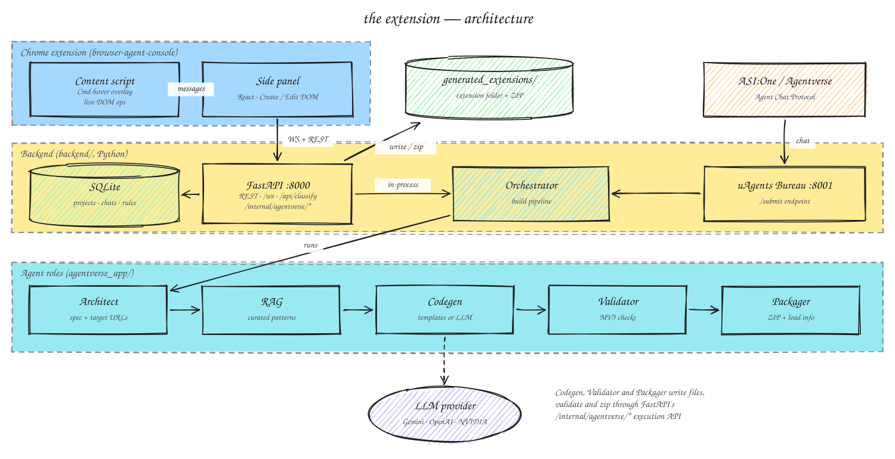

# the extension

> personalize your browsing experience in seconds

**the extension** is a Chrome side panel backed by an Agentverse agent pipeline that turns one sentence into a real, installable Manifest V3 Chrome extension. You describe what you want ("hide YouTube comments and Shorts"), and an Orchestrator runs it through Architect, RAG, Codegen, Validator and Packager roles, writes the files, validates the manifest, zips the result and hands back a Load Unpacked card. The same Orchestrator is registered on Agentverse, so it can also be reached from ASI:One.

It also has an **Edit DOM mode**: hold Cmd, hover any element on a page, click to select it, and tell the agent things like "make this 30% wider", "hide it" or "change the text to 'inbox zero'". Edits apply live, and one button exports them as a permanent extension that re-applies them every time you visit that site.

- Landing page: **[thewebisboring.design](https://thewebisboring.design)**
- Public agent on ASI:One / Agentverse: **[the extension orchestrator](https://agentverse.ai/agents/details/agent1q0a82jftlsmgjnuxw32mm2ewhtsyr4mnhke8tnmxv34nra5qjz8uzvmwgkw/profile)**
- Built at **[LA Hacks](https://lahacks.com)** for the Flicker to Flow track.

## Architecture



- **Side panel** (`browser-agent-console/src/sidepanel/`) is the React UI for Create and Edit DOM modes. It talks to the backend at `http://localhost:8000` over a WebSocket (`/ws/{project_id}`) for builds and REST for projects, conversations, rules, DOM-edit export and loading extensions.
- **Content script** (`src/content/`) runs on every page: it draws the Cmd-hover selection overlay, returns page/element HTML to the panel, and applies live DOM operations.
- **FastAPI backend** (`backend/main.py`, port 8000) stores projects, conversations and rules in SQLite (`conversations.db`), runs the build pipeline in-process for side-panel requests, and exposes `/api/classify` (LLM content filtering used by generated extensions) and `/api/dom-edits/export`.
- **uAgents Bureau** (`backend/agentverse_app/main.py`, port 8001) hosts the Orchestrator plus five specialist agents. The Orchestrator speaks the Agent Chat Protocol, so ASI:One / Agentverse messages arrive at its public `/submit` endpoint.
- **Orchestrator** (`agentverse_app/orchestrator.py`) runs the roles in order and streams progress events (`tool_start`, `tool_end`, `extension_ready`) back to the panel.
- **Architect** turns the prompt into an extension spec with target URLs; **RAG** adds curated MV3 patterns and site-specific context; **Codegen** uses deterministic templates for known use cases and falls back to an LLM (Gemini by default, OpenAI or NVIDIA selectable).
- **Validator** and **Packager**, like Codegen, call the token-protected `/internal/agentverse/*` execution API, which writes files to `backend/generated_extensions/<project_id>/`, runs Manifest V3 checks and produces a ZIP plus load instructions.

## Features

- Prompt-to-extension: plain-English request in, validated MV3 folder and ZIP out, with an install card in the side panel.
- Edit DOM mode: Cmd-hover to select elements, describe changes, preview live, export as a persistent extension.
- Agentverse / ASI:One integration: the Orchestrator is a registered Chat Protocol agent; replies include a download link when `PUBLIC_BACKEND_BASE_URL` is set.
- Static validation of generated extensions (manifest, referenced files, syntax) before packaging.
- Semantic filtering endpoint (`/api/classify`) that generated extensions can call instead of hardcoded keyword lists.
- Optional macOS automation (`/api/load-extension/{project_id}`) that drives Chrome's Load unpacked dialog via AppleScript.
- Multiple LLM providers: Gemini (default), OpenAI and NVIDIA via OpenAI-compatible clients.

## Tech stack

- **Extension:** React 19, TypeScript, Vite 7, `@crxjs/vite-plugin`, Chrome Manifest V3 (side panel, content scripts, scripting)
- **Backend:** Python 3.12, FastAPI, Uvicorn, WebSockets, aiosqlite, Pydantic, OpenAI SDK, LangChain, NetworkX/NumPy (graph RAG utilities)
- **Agents:** Fetch.ai `uagents` / `uagents-core` (Bureau, Agent Chat Protocol, Agentverse registration)
- **Tooling:** `uv`, npm, ngrok

## Getting started

### Requirements

- Python 3.12+ and [`uv`](https://github.com/astral-sh/uv)
- Node.js 18+ and npm
- Chrome or Chromium
- [`ngrok`](https://ngrok.com) (free tier is fine) if you want Agentverse / ASI:One to reach your agents

### Install

```bash
git clone https://github.com/aidanjnn/the-extension.git
cd the-extension

cd backend && uv sync && cd ..
cd browser-agent-console && npm install && cd ..
```

### Environment

Create `backend/.env` (gitignored). Variables read by the code:

| Variable | Purpose |
| --- | --- |
| `GEMINI_API_KEY` | Default LLM provider (Codegen fallback, `/api/classify`, titles) |
| `OPENAI_API_KEY`, `NVIDIA_API_KEY` | Optional alternative providers |
| `AGENTVERSE_API_KEY` | Registering agents on Agentverse (`agentverse_app.register`) |
| `PUBLIC_AGENT_BASE_URL` | Public URL of the uAgents server (Bureau endpoint is `<url>/submit`) |
| `PUBLIC_BACKEND_BASE_URL` | Public URL of FastAPI, used to build ZIP download links |
| `BACKEND_EXECUTION_API_URL` | Where agents reach FastAPI (defaults to `http://localhost:8000`) |
| `UAGENTS_PORT` | Bureau port (defaults to 8001) |
| `AGENTVERSE_EXECUTION_TOKEN` | Shared token for `/internal/agentverse/*` |
| `ORCHESTRATOR_SEED`, `ARCHITECT_SEED`, `RAG_SEED`, `CODEGEN_SEED`, `VALIDATOR_SEED`, `PACKAGER_SEED` | Agent identities; keep them stable unless you want to register fresh agents |
| `ENABLE_GRAPH_RAG` | Optional flag for the RAG role (default `false`) |

To expose both servers with one command, define two tunnels in your ngrok config (e.g. `~/Library/Application Support/ngrok/ngrok.yml`):

```yaml
version: "3"
agent:
  authtoken: <your-ngrok-authtoken>
tunnels:
  uagents:
    proto: http
    addr: 8001
    domain: <your-static-ngrok-domain>.ngrok-free.dev
  backend:
    proto: http
    addr: 8000
```

The `uagents` tunnel needs a static domain so Agentverse can keep reaching your registered agent; the `backend` tunnel can be ephemeral.

### Run

Four terminals:

```bash
# 1. FastAPI backend (port 8000)
cd backend && uv run main.py

# 2. uAgents Bureau / Chat Protocol server (port 8001)
cd backend && uv run python -m agentverse_app.main

# 3. ngrok tunnels (only needed for Agentverse / ASI:One)
ngrok start uagents backend

# 4. Extension dev build
cd browser-agent-console && npm run dev
```

After ngrok prints the backend URL, put it in `PUBLIC_BACKEND_BASE_URL` and restart FastAPI. To register the agents on Agentverse once they are reachable, run `uv run python -m agentverse_app.register` from `backend/`.

Then open `chrome://extensions`, enable Developer mode, click **Load unpacked**, select `browser-agent-console/dist`, and pin the side panel. For a production build use `npm run build`.

### Try it

In the side panel (or via ASI:One on the agent's [public page](https://agentverse.ai/agents/details/agent1q0a82jftlsmgjnuxw32mm2ewhtsyr4mnhke8tnmxv34nra5qjz8uzvmwgkw/profile)):

```text
Hide YouTube comments and Shorts on the homepage.
```

You should see progress events, an `extension_ready` install card, and a folder plus ZIP under `backend/generated_extensions/`. Load the unpacked folder, refresh YouTube, and the comments are gone.

## Project structure

```text
backend/
  main.py               FastAPI routes, WebSocket chat, DOM-edit export, execution API
  agentverse_app/       uAgents Bureau, Orchestrator and Architect/RAG/Codegen/Validator/Packager roles
  utils/                SQLite store, MV3 validator, workspace + packaging, provider config, graph RAG
  tests/                pytest tests
browser-agent-console/
  manifest.config.ts    MV3 manifest (side panel, content script, permissions)
  src/sidepanel/        Create / Edit DOM UI
  src/content/          Cmd-hover overlay and live DOM ops
  src/background.ts     service worker
docs/architecture.svg   diagram above (source: docs/architecture.json)
ARCHITECTURE.md         deeper architecture reference with sequence diagrams
DEVPOST.md              Devpost submission writeup
```
